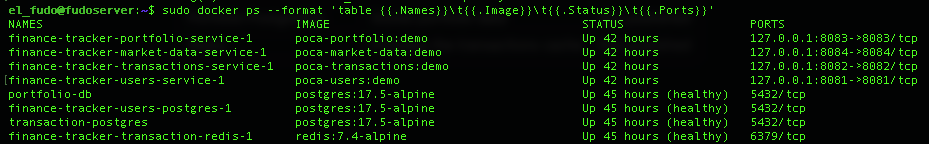
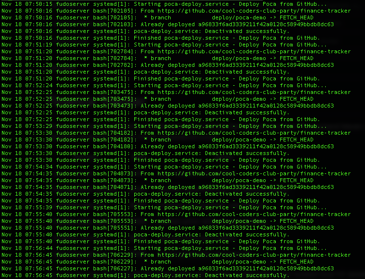

# Póca — Continuous Deployment

This document explains how Póca is checked, deployed and run on the T460 Ubuntu server, and how the team releases updates.

> **Deployment rule:** The server automatically deploys the latest commit on `deploy/poca-demo` after a successful push-triggered `Poca CI` run for that exact commit. Merging into `main` alone does not update the live site.

The server configuration and screenshots in this document were inspected on **18 November 2026**.

## Contents

- [Infrastructure](#infrastructure)
- [Running components](#running-components)
- [Automatic deployment](#automatic-deployment)
- [Deployment verification](#deployment-verification)
- [Web serving and API routing](#web-serving-and-api-routing)
- [Releasing updates](#releasing-updates)
- [Appendix: commented deployment script](#appendix-commented-deployment-script)

## Infrastructure

### Ubuntu server

The T460 runs Ubuntu, which hosts Póca and runs Docker, Caddy, Cloudflare Tunnel and the scheduled deployment script.

### Docker

Docker runs the four backend applications, three PostgreSQL databases and Redis in separate containers. The frontend is built in a temporary container, then served as static files by Caddy.

### Docker Compose

Docker Compose defines how the containers are configured and run together. The deployment combines two files:

| File | Role |
| --- | --- |
| `compose.yml` | Defines the PostgreSQL databases, Redis and persistent database volumes. |
| `compose.demo.yml` | Adds the backend applications and demo deployment settings, including removing published database and Redis ports. |

Both files are used together so the shared infrastructure configuration can be reused while the demo-specific settings stay separate. The second file adds to or overrides the first.

**Why is market-data in Compose without a database?** Market-data-service needs a running application container to provide its API. A service does not need a database to use Docker Compose. Portfolio-service is configured to contact market-data-service over Docker's internal network.

### Caddy

Caddy serves the built frontend from `/var/www/poca` and forwards API requests to the appropriate backend container. This lets the browser access the frontend and backend through one website address.

### Cloudflare

Cloudflare provides the public entry point to Póca. The `cloudflared` service on the T460 maintains an outbound tunnel to Cloudflare, allowing visitors to reach the website without opening incoming ports on the home router. Cloudflare handles public HTTPS connections and sends requests through the tunnel to the configured service on the server.

The tunnel's routing is managed through Cloudflare's dashboard. The server authenticates using a token file; secret values are not included in this document. The dashboard destination has not yet been checked as part of this review, so forwarding to Caddy on port `8090` still needs confirmation.

## Running components

Póca runs as eight persistent Docker containers: four backend applications, three PostgreSQL databases and one Redis cache.

The backend APIs are published on the server's loopback address (`127.0.0.1`) at ports `8081–8084`. The databases and Redis have no published host ports.

| Component | Purpose | Published host port |
| --- | --- | --- |
| Users service | Runs the users API | `127.0.0.1:8081` |
| Transactions service | Runs the transactions API | `127.0.0.1:8082` |
| Portfolio service | Runs the portfolio API | `127.0.0.1:8083` |
| Market-data service | Runs the market-data API | `127.0.0.1:8084` |
| Users PostgreSQL | Stores users data | Not published |
| Transactions PostgreSQL | Stores transactions data | Not published |
| Portfolio PostgreSQL | Stores portfolio data | Not published |
| Redis | Provides the transactions cache | Not published |



*Running containers inspected on 18 November 2026. Application uptime alone does not verify that an API is healthy.*

## Automatic deployment

### Scheduling

The T460 checks the `deploy/poca-demo` branch using a systemd timer.

| Component | Role |
| --- | --- |
| `poca-deploy.timer` | Schedules the deployment task and is enabled to start at boot. |
| `poca-deploy.service` | Runs `/home/el_fudo/bin/poca-deploy` as `el_fudo`, with Docker group access. |

The timer schedules its first run about one minute after boot. Subsequent runs are scheduled about one minute after the previous service run finishes, with a five-second accuracy window. During the checks shown below, this resulted in approximately 65 seconds between runs. A deployment takes additional build and startup time.

### Deployment sequence

Each check fetches the deployment branch's latest commit and compares it with the last successfully deployed commit. If the commit is new, the script waits for a successful push-triggered GitHub Actions run named `Poca CI` for that exact commit.

| Step | What the server does | Why |
| --- | --- | --- |
| 1 | Works in `/home/el_fudo/apps/poca-live` | Uses the deployment checkout. |
| 2 | Fetches `deploy/poca-demo` from GitHub | Finds the latest commit without changing local files yet. |
| 3 | Compares the commit with the saved deployment record | Skips commits already recorded as successfully deployed. |
| 4 | Checks for a successful push run named `Poca CI` for that commit | Requires CI to pass before deployment. |
| 5 | Updates the checkout using `git merge --ff-only` | Moves to the target commit; stops if a fast-forward is not possible. |
| 6 | Builds the frontend in a temporary Node 22 container | Produces `frontend/dist/`. |
| 7 | Runs Docker Compose with both Compose files | Builds backend images and creates or updates the containers. |
| 8 | Checks backend HTTP endpoints | Performs basic checks before publishing the frontend. |
| 9 | Copies `frontend/dist/` to `/var/www/poca/` | Publishes the frontend files for Caddy to serve. |
| 10 | Records the deployed commit | Marks the version as successfully deployed. |

**GitHub checks the code; the T460 builds and deploys it.** The server builds its own frontend and backend images rather than downloading application build outputs from CI. CI is defined in `.github/workflows/poca-ci.yml`; the checks depend on the workflow version on the branch being built.

### Deployment checks and limitations

- Users-service must respond successfully at `/api/auth/ping`.
- Transactions-service and market-data-service must return successful HTTP responses from `/actuator/health`.
- Portfolio-service must return `401 Unauthorized` from `/actuator/health`. This confirms an authentication-protected response, rather than full application or database health.
- If a required command fails, the script stops and does not record the new commit as successfully deployed. A later timer run can retry it.
- There is no automatic rollback. Backend containers may already have changed if a later check or frontend publication fails.

The full script, with comments explaining each command, is included in the [appendix](#appendix-commented-deployment-script).

## Deployment verification

On 18 November 2026, the service logs confirmed that the server was automatically checking GitHub approximately every 65 seconds.

To inspect recent deployment logs, run this command on the T460. It displays the latest 60 log entries without changing the deployment:

```bash
sudo journalctl -u poca-deploy.service -n 60 --no-pager
```



The latest deployment-branch commit at the time was `a96833f`, matching the server's saved successful deployment record. Each check therefore reported `Already deployed` and finished without rebuilding.

These checks verify whether a new deployment is needed; they do not continuously check application health.

## Web serving and API routing

Caddy is configured to serve Póca on `127.0.0.1:8090`. It serves the built frontend from `/var/www/poca` and forwards matching API requests to the backend containers.

| Incoming path | Destination | Path handling |
| --- | --- | --- |
| `/api/auth*` | Users-service on `127.0.0.1:8081` | Keeps the request path. |
| `/api/v1/transactions*` | Transactions-service on `127.0.0.1:8082` | Keeps the request path. |
| `/portfolio-api/*` | Portfolio-service on `127.0.0.1:8083` | Removes the `/portfolio-api` prefix. |
| `/market-data/*` | Market-data-service on `127.0.0.1:8084` | Removes the `/market-data` prefix. |
| All other paths | Frontend files in `/var/www/poca` | Falls back to `index.html` when a matching file does not exist. |

The `index.html` fallback allows the frontend router to handle navigation when someone opens or refreshes an application URL directly.

## Releasing updates

1. Develop changes on a branch from `main` and open a pull request into `main`.
2. Review the changes and CI results, then merge the pull request.
3. When the team is ready to release, open a pull request from `main` into `deploy/poca-demo`. Review the full release diff and confirm that required containers, settings and Caddy routes are available.
4. Merge the release pull request. This advances the deployment branch and triggers its push CI run.
5. The T460 detects the new commit, waits for that commit's CI to pass, and deploys automatically. Check the deployment logs and the live features afterwards.

Routine releases do not require manually pulling code or restarting containers on the server. A documentation-only change on the deployment branch can also trigger deployment: the current script checks commit hashes, not which files changed.

As of this review, `main` includes a reporting feature, but the inspected demo Compose and Caddy configurations do not include a reporting-service container or an `/api/reports` proxy route. That integration needs to be addressed before expecting CSV reporting to work in the live demo. A development-only Vite proxy does not configure Caddy.

## Appendix: commented deployment script

This is a commented reference copy of `/home/el_fudo/bin/poca-deploy`, inspected on 18 November 2026. Editing this documentation does not update the script installed on the server.

```bash
#!/usr/bin/env bash
# Run this script using Bash, located through the system's PATH.

set -euo pipefail
# -e: Stop if a command fails, subject to Bash's conditional rules.
# -u: Stop if the script uses an unset variable.
# -o pipefail: Treat a pipeline as failed if any command in it fails.
#
# These settings help stop deployment from continuing after an error.
# They do not undo changes already made.


# ============================================================
# 1. Set the deployment directory, branch and state location
# ============================================================

cd "$HOME/apps/poca-live"
# Enter the repository checkout used for deployment.
# The systemd service sets HOME to /home/el_fudo, so this becomes:
# /home/el_fudo/apps/poca-live

branch=deploy/poca-demo
# This is the GitHub branch the server deploys.
# Changes on main alone will not be picked up by this script.

state="$HOME/.local/state/poca"
# Directory where we keep a record of the last successful deployment.

mkdir -p "$state"
# Create the state directory if needed.
# -p also creates missing parent directories and allows it to exist already.


# ============================================================
# 2. Find the latest commit on the deployment branch
# ============================================================

git fetch --no-tags origin "refs/heads/$branch"
# Download the deployment branch's latest Git history from origin.
# --no-tags avoids fetching tags automatically.
# Fetching does not yet change the checked-out application files.

target=$(git rev-parse FETCH_HEAD)
# FETCH_HEAD identifies the commit fetched by the previous command.
# Store its full commit hash in the variable "target".
# This identifies the exact version we are considering for deployment.


# ============================================================
# 3. Skip commits already recorded as successfully deployed
# ============================================================

if [[ -f "$state/deployed" && $(cat "$state/deployed") == "$target" ]]; then
# Check both:
# 1. Does the deployment record file exist?
# 2. Does it contain the same commit hash as the target?
#
# If both are true, this version was already recorded as deployed.

  printf 'Already deployed %s\n' "$target"
  # Print the commit hash into the service's logs.

  exit 0
  # Finish successfully without rebuilding or restarting anything.
fi
# This check compares commit hashes; it does not check container health
# or detect manual changes to the running deployment.


# ============================================================
# 4. Require successful CI for this exact commit
# ============================================================

passed=$(gh run list --repo cool-coders-club-party/finance-tracker \
  --branch "$branch" --commit "$target" --event push --status success \
  --json workflowName --jq 'any(.[]; .workflowName == "Poca CI")')
# Use the GitHub CLI ("gh") to find successful workflow runs:
#
# --repo: Search the team's finance-tracker repository.
# --branch: Limit results to deploy/poca-demo.
# --commit: Require the exact target commit.
# --event push: Look for runs triggered by a push, including a merge.
# --status success: Return only successful runs.
# --json workflowName: Return the workflow names as JSON.
# --jq: Return true if any returned workflow is named "Poca CI".
#
# Store the resulting true/false value in "passed".
# The GitHub CLI must already be authenticated on the server.

if [[ "$passed" != true ]]; then
  printf 'Waiting for Poca CI to pass for %s\n' "$target"
  # CI might still be running, have failed, or have no matching run.

  exit 0
  # Finish this check without deploying.
  # The systemd timer will trigger another check later.
fi


# ============================================================
# 5. Update the deployment checkout to the approved commit
# ============================================================

git merge --ff-only "$target"
# Move the checkout forward to the target commit.
# --ff-only permits a fast-forward update without a merge commit.
# If the local history has diverged, Git fails and the script stops.
# This is not a command that forcefully overwrites the checkout.

[[ "$(git rev-parse HEAD)" == "$target" ]]
# Verify that the checkout's current commit is exactly the target.
# If it is not, this check fails and the script stops.


# ============================================================
# 6. Build the frontend in a temporary Node.js container
# ============================================================

docker run --rm --user "$(id -u):$(id -g)" \
  -e npm_config_cache=/tmp/npm-cache \
  -v "$PWD/frontend:/app" -w /app \
  node:22-bookworm sh -c 'npm ci && npm run build'
# docker run: Start a container for this build.
#
# --rm:
# Remove the container after it exits.
# This container does not stay running to serve the website.
#
# --user "$(id -u):$(id -g)":
# Run as the current user's numeric user and group IDs.
# This helps avoid creating root-owned files in the frontend directory.
#
# -e npm_config_cache=/tmp/npm-cache:
# Put npm's cache in a writable temporary directory inside the container.
#
# -v "$PWD/frontend:/app":
# Mount the server's frontend directory at /app inside the container.
# Files written there also appear in the server's frontend directory.
#
# -w /app:
# Run the commands from /app.
#
# node:22-bookworm:
# Use a Node.js 22 image based on Debian Bookworm.
#
# npm ci:
# Install dependencies using package-lock.json.
#
# && npm run build:
# Build the frontend only if dependency installation succeeds.
# The build produces frontend/dist/ on the server.
#
# Tests are not run by this command; the script already checked CI.


# ============================================================
# 7. Build and start/update the backend with Docker Compose
# ============================================================

docker compose --project-name finance-tracker \
  --env-file "$HOME/.config/poca/demo.env" \
  -f compose.yml -f compose.demo.yml up -d --build
# --project-name finance-tracker:
# Use a consistent project name to identify this deployment's
# containers, default network and other Compose resources.
#
# --env-file:
# Read deployment variables from a file kept on the server.
# Compose uses these values to resolve settings such as JWT secrets.
# Keep this file's secret values out of documentation and Git.
#
# -f compose.yml -f compose.demo.yml:
# Combine the two files in this order.
# compose.yml defines the databases, Redis and persistent volumes.
# compose.demo.yml adds the backend applications and overrides
# settings, including removing published database/cache ports.
#
# up:
# Create or update containers to match the combined configuration.
# Compose can recreate containers when their image or settings change.
#
# -d:
# Leave containers running in the background.
#
# --build:
# Build application images on the T460 before starting containers.
# The script does not download the application images built in CI.
#
# Market-data-service runs here because it is a backend application.
# A containerised application does not need a database to use Compose.
#
# Database data is stored in the named volumes defined in compose.yml.
# This command does not request that those volumes be deleted.


# ============================================================
# 8. Check that backend endpoints respond
# ============================================================

retry=(--retry 240 --retry-all-errors --retry-delay 2 --max-time 5)
# Define a Bash array containing curl options:
#
# --retry 240: Allow up to 240 retries after the initial attempt.
# --retry-all-errors: Retry errors curl considers failures.
# --retry-delay 2: Wait two seconds between retries.
# --max-time 5: Limit each individual attempt to five seconds.
#
# This gives services time to start.
# Five seconds is not the total time limit for all retries combined.

curl -fsS "${retry[@]}" http://127.0.0.1:8081/api/auth/ping
# Check the users-service authentication ping endpoint.
#
# -f: Treat HTTP error responses, such as 401 or 500, as failures.
# -s: Hide curl's progress meter.
# -S: Still display error messages.
#
# 127.0.0.1 addresses the T460 itself.
# "${retry[@]}" passes each retry option as a separate argument.

for port in 8082 8084; do
  curl -fsS "${retry[@]}" "http://127.0.0.1:$port/actuator/health"
done
# Check Spring Boot Actuator health endpoints for:
# 8082: transactions-service
# 8084: market-data-service
#
# These commands require a successful HTTP response.
# They print the response body but do not explicitly parse its JSON.

portfolio_status=$(curl -sS "${retry[@]}" -o /dev/null -w '%{http_code}' \
  http://127.0.0.1:8083/actuator/health)
# Contact portfolio-service and capture its HTTP status code.
#
# -o /dev/null: Discard the response body.
# -w '%{http_code}': Output only the HTTP status code.
#
# Unlike the earlier curl commands, this deliberately omits -f,
# so an HTTP 401 response can be captured without curl failing.

[[ "$portfolio_status" == 401 ]]
# Require 401 Unauthorized from the portfolio endpoint.
# This confirms that it responds and requires authentication.
# It does not prove the portfolio database or business functions work.
#
# If any required check fails, the script stops before publishing
# the frontend. Backend containers may already have been updated.


# ============================================================
# 9. Publish the built frontend files
# ============================================================

rsync -a --delay-updates frontend/dist/ /var/www/poca/
# Copy the CONTENTS of frontend/dist/ into /var/www/poca/.
# A web server must be configured separately to serve that directory.
#
# -a: Copy recursively while preserving file attributes where possible.
#
# --delay-updates:
# Hold updated files temporarily, then move them into place near
# the end of the transfer. This reduces partially updated files.
# It does not make the entire website update one atomic operation.
#
# There is no --delete option, so destination files missing from
# the new build are not automatically removed.


# ============================================================
# 10. Record successful completion
# ============================================================

printf '%s\n' "$target" > "$state/deployed"
# Save the deployed commit hash, replacing the previous record.
# This happens only after all earlier commands succeed.
# Future checks skip this commit once it is recorded here.

printf '\nDeployed %s\n' "$target"
# Write a success message to the service's logs.
#
# If deployment fails before this point, the new commit is not
# recorded as successfully deployed and a later timer run can retry.
#
# There is no automatic rollback: stopping on an error does not
# restore containers or files changed earlier in the script.
```
